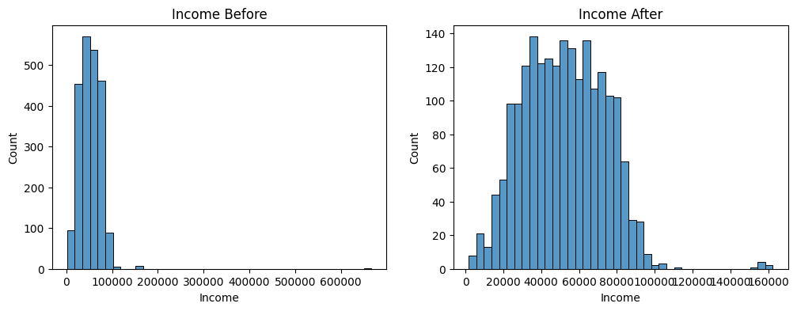
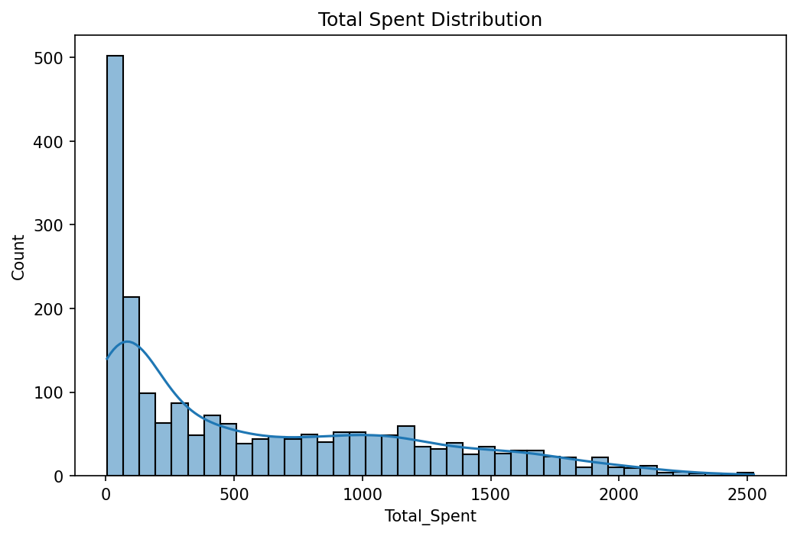
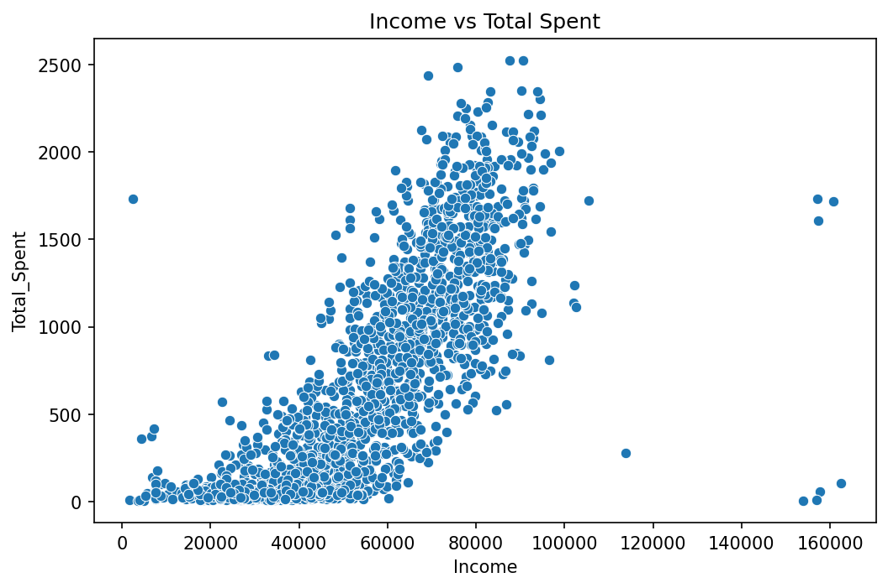
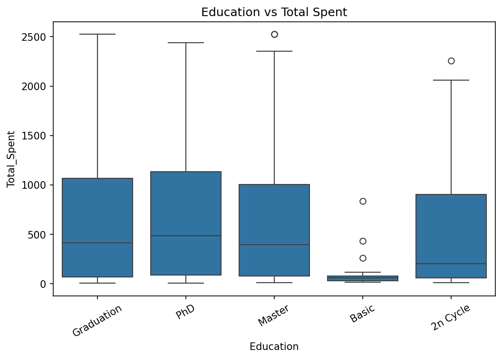
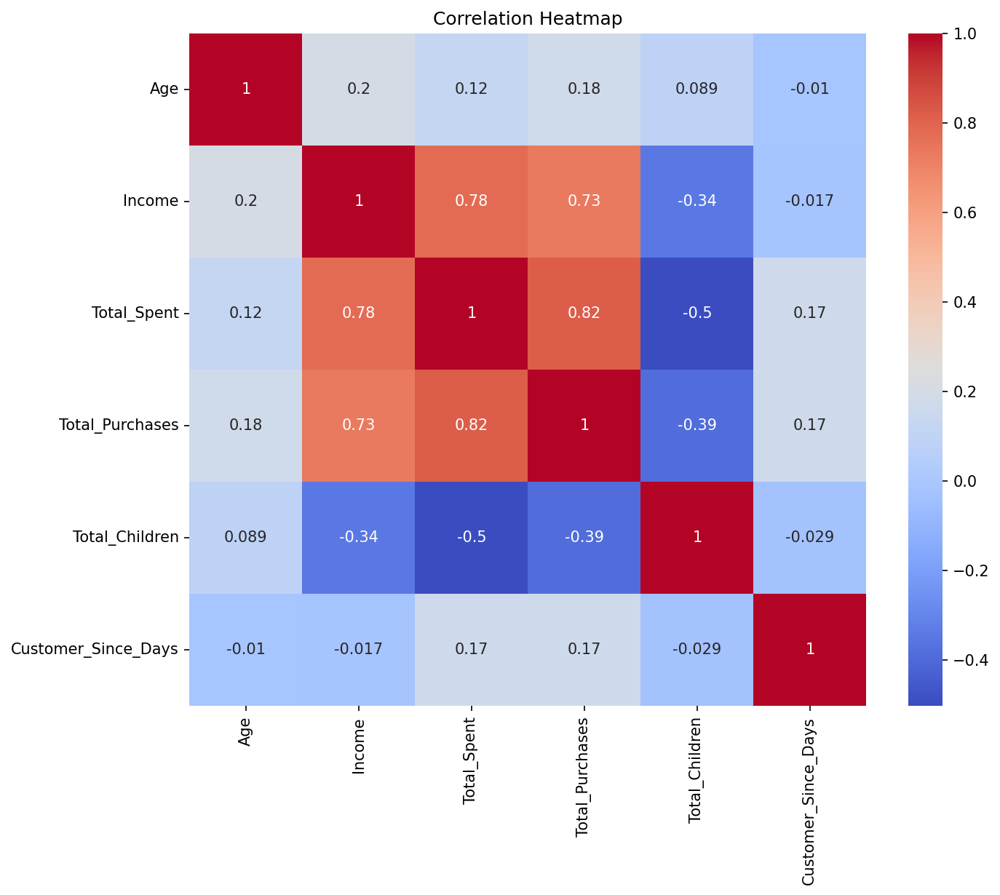

# Customer Data Cleaning

Data cleaning, feature engineering and exploratory analysis on a marketing campaign customer dataset, using Python and pandas.

The raw data has missing values, duplicate customers, impossible birth years, an extreme income outlier, and invalid marital-status labels. This project cleans all of that, adds features that are ready for analysis or segmentation, and explores how customer spending relates to income, education and family size.

## Results

| | Raw | Cleaned |
|---|---|---|
| Rows | 2,240 | 2,050 |
| Columns | 29 | 32 |
| Missing values | 24 (Income) | 0 |
| Duplicate rows (ignoring ID) | 182 | 0 |



## Cleaning steps

1. **Duplicates:** removed 182 rows that were identical in every column except `ID`.
2. **Marital status:** merged `Alone` into `Single` and dropped the invalid labels `Absurd` and `YOLO`.
3. **Dates:** converted `Dt_Customer` from text to datetime.
4. **Outliers:** removed customers born before 1920 and one customer with an income of 666,666. Four rows were removed in total.
5. **Missing values:** filled the 24 missing `Income` values with the median.
6. **Constant columns:** dropped `Z_CostContact` and `Z_Revenue`, which hold a single value in every row.

## New features

| Feature | Description |
|---|---|
| `Age` | Latest customer-signup year minus birth year |
| `Total_Spent` | Sum of all `Mnt*` product spending columns |
| `Total_Purchases` | Web + catalog + store purchases |
| `Total_Children` | `Kidhome` + `Teenhome` |
| `Customer_Since_Days` | Days between signup and the most recent signup in the data |

## Exploratory analysis

### Spending distribution



Spending is heavily right-skewed. The median customer spends 396, and 650 of the 2,050 customers (about 32%) spent less than 100, while a small group spends over 2,000.

### Income vs spending



Spending rises with income, with a correlation of 0.78. Customers below roughly 30,000 income almost never spend much, while spending varies widely above 60,000.

### Education vs spending



Customers with `Basic` education spend far less (median 57) than `Graduation`, `Master` and `PhD` customers (medians between 394 and 484). `2n Cycle` sits in between at 202. `Basic` has only 49 customers, so treat that group with caution.

### Correlations



- `Total_Spent` is strongly correlated with `Total_Purchases` (0.82) and `Income` (0.78).
- `Total_Children` is negatively correlated with `Total_Spent` (-0.50) and with `Income` (-0.34).
- `Age` and `Customer_Since_Days` have weak correlations (0.2 or lower) with the other variables.

## Project structure

```
customer-data-cleaning/
├── data/
│   ├── raw/                  original dataset (semicolon-separated)
│   └── processed/            cleaned dataset
├── images/                   plots used in this README
├── notebooks/
│   └── customer_data_cleaning.ipynb
├── src/
│   └── clean_data.py         the cleaning pipeline as a runnable script
├── requirements.txt
└── README.md
```

## How to run

```bash
git clone https://github.com/menna753-afk/customer-data-cleaning.git
cd customer-data-cleaning
pip install -r requirements.txt
```

Run only the cleaning pipeline:

```bash
python src/clean_data.py
```

Or open the notebook for the full analysis and plots:

```bash
jupyter notebook notebooks/customer_data_cleaning.ipynb
```

Both write the cleaned data to `data/processed/marketing_campaign_clean.csv`. The notebook also saves the plots to `images/`.

## Notes

- The raw file uses `;` as the separator, so it must be read with `sep=";"`.
- Duplicates were detected ignoring `ID`, since the same customer can appear under different IDs. If you prefer to keep them, remove the deduplication step.
- Imputing income with the median is a simple choice. Grouping by education level would be a reasonable refinement.
- Seven customers have an income above 150,000. Four of them spend very little (under 110) while three spend over 1,600. They were kept because the income values are plausible, but they are worth reviewing before modeling.

## Tools

Python, pandas, NumPy, Matplotlib, Seaborn
